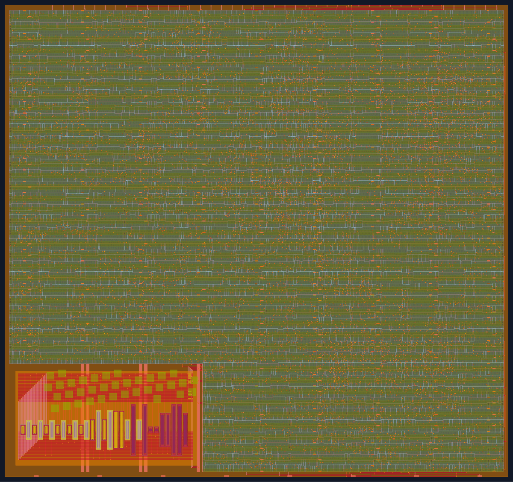

# GF26e differential byte transceiver — 1×2

A complete GF180 differential byte transceiver and autonomous loopback tester in one Tiny Tapeout GF26e **1×2 analog frame: 346.64 × 325.36 µm**, with four analog pins. It retains the native 3.3 V PHY, 8N1 serial TX/RX, SPI registers, five test patterns, the complete 32-bit counter/target interface, coherent snapshots and independent receive checking. Default line rate is 100 kbit/s from a 1.6 MHz clock.

**The selected local 1×2 candidate is `compact_23b`.** Detailed routing has zero violations; all nine extracted timing corners pass, including explicit clock-gate enable/pulse audits. The final filled GDS passes full transistor/resistor LVS and all 12 official prechecks. Actual mapped and routed digital regressions pass all 44 cases. Digital placement utilization is **89.7005%**, using 89,526.8 µm² of non-filler standard cells plus an 8,125 µm² analog macro. Exact-commit remote Actions results remain pending. See [verification scope and evidence](docs/VERIFICATION.md) and [official target sources](docs/TARGET.md).




## Architecture and testing

Software sends and receives ordinary bytes over SPI. Self-test generates PRBS8, alternating 55/AA, walking ones, walking zeros or a fixed byte. The receiver independently detects and samples incoming frames and compares payloads with its own expected sequence. Seven public 32-bit values report checked bytes/bits, mismatched bytes/bits, framing errors, timeouts and normal receive overruns. Checked payload bits are saturated eight times checked bytes. Timeout storage is losslessly compressed to a flag because a timeout ends the run; its public value is zero-extended to 32 bits. Overflow disqualifies PASS, and one command captures a coherent snapshot for slow SPI reads.

Compaction preserves this interface. The digital implementation has **598 flip-flops and 16 native clock gates**: 15 functional gates and one always-enabled gate that balances clock insertion delay for the remaining 317 flip-flops. Every gate's test-enable input is tied low. The 125 × 65 µm PHY retains the original 20 MOSFETs, nine resistors and exact primitive dimensions.

For same-project physical loopback, connect ua[0] TX+ to ua[2] RX+, and ua[1] TX- to ua[3] RX-. This exercises the transmitter and receiver through the shuttle analog access switches. A compatible USB controller supplies the clock and reads status/counters; functional readout needs no oscilloscope. Carrier connector mapping and controller firmware still need validation. Normal receive has one holding register and no FIFO or flow control, so software must pace transfers.

- [Register protocol](REGISTERS.md)
- [Host driver and test setup](host/README.md)
- [Datasheet source](docs/info.md)
- [Local EDA and rebuild instructions](tools/README.md)

## Reproduce the implementation

After the pinned local EDA setup, stage the selected compact macro and invoke the balanced-clock driver. Use a fresh run tag:

```sh
python3 experiments/compact-phy/check_package.py
mkdir -p build/physical/phy
cp experiments/compact-phy/selected/gf180_diff_phy.gds experiments/compact-phy/selected/gf180_diff_phy.lef build/physical/phy/
GF_RUN=gf26e_compact_rebuild_01
python3 scripts/test_rtl.py
python3 tools/run_librelane.py python3 tools/gf180_balanced_clockgate_flow.py --manual-pdk --pdk-root /pdk --pdk gf180mcuD --scl gf180mcu_fd_sc_mcu7t5v0 --run-tag "$GF_RUN" physical/compact_23b.json
```

The driver verifies its pinned synthesis implementation and ties native clock-gate test enables low. `SYNTH_ARITH_TREE=false` remains required by the unchanged digital regression. Capture exact inputs before a new build, retain its executed command and continuation receipts, and run the final gates described in [the local EDA instructions](tools/README.md). A completed placement stage alone does not qualify a candidate.

The selected macro package contains its generator, immutable primitive inputs, geometry comparison and electrical evidence. Its historical notes describe the original macro-only experiment; the integrated 1×2 result is documented separately. Required official COMP fill adds only Dummy COMP layer 22/4; every other mask region, label and tile boundary is unchanged.

## GitHub Actions

| Workflow | Scope |
|---|---|
| `rtl` | External-pin digital regression with a behavioral PHY boundary; log and JSON summary. |
| `gds` | Checks committed source/artifact hashes, creates custom-layout GDS/OAS/PNG artifacts, and runs unchanged official prechecks with the GF26e PDK. |
| `docs` | Validates metadata and builds a PDF datasheet artifact. |

Actions support manual dispatch; full place-and-route and analog extraction use the local toolchain. Artifact packaging does not rerun physical implementation. Permissions remain `contents: read`; the repository and its artifacts stay private, with no Pages deployment. Inspect results on the delivered exact commit before using remote artifacts.

## Evidence history and electrical scope

The earlier 2×2 release at `dc81136485ec0d8a0e100307a48a231a246e4c7f` remains unchanged in its original checkout. Its `verification/integrated` archive is historical and does not qualify `compact_23b`; the selected evidence is archived in `verification/compact-1x2/`. Earlier unsuccessful 1×2 trials are retained under `experiments/compact-transceiver`; their intermediate results are not the selected candidate's signoff.

The project uses VDPWR = 3.3 V and VGND, with `uses_vapwr: false`. Shared shuttle switches independently use global VAPWR, whose actual carrier voltage remains unconfirmed. Loaded simulations cover assumed 3.3 V and 5.0 V switch supplies. Carrier power/wiring, package/board parasitics, coupling/noise, full post-fill shuttle integration and silicon testing remain separate. This PHY is not qualified as LVDS or RS-485; do not assume standard differential termination.

No slot reservation, purchase or shuttle submission has been performed.
